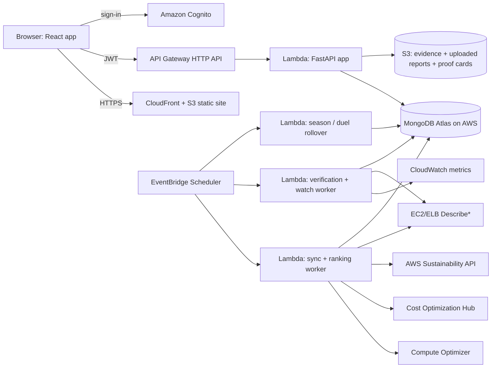

# OVERCLOUDED.SI — MASTER BUILD PROMPT

> **HUMAN: Section 0 is already filled in with your details. Review it, then paste this whole file into a coding LLM / agent as one message (or attach it and say "Execute this prompt, starting with the Output Protocol in Part G").**

---

## SECTION 0 — PROJECT CONTEXT

| Item | Value |
|---|---|
| **Product name** | **Overclouded.si** (use exactly this string for branding; code identifiers, package names and repo folder use `overclouded`). The name plays on "over-provisioned" and "over-clouded": a cloud estate covered in clouds of waste that the team clears. |
| **Domain** | Treat `overclouded.si` as the *intended* domain only. Do not assume it is registered or that DNS can be managed in AWS. The app must work fully on the default CloudFront URL; a custom-domain setup (ACM certificate + DNS records) is an optional documented step. |
| **Hackathon / track** | AWS-themed hackathon, Track: **Waste and Energy**. Deadline not given: assume 7–10 days of build time. |
| **Team** | **4 developers.** Work is split into four parallel tracks (Part D0). |
| **Judging criteria** | **(1) Gamification**: how engaging and behaviour-changing the game layer is. **(2) Tackles / points out real AWS problems**: concretely detects and fixes real AWS waste problems, with proof. **(3) Unique idea**: originality. Part A4 maps these to features. Every design decision should be tested against these three. |
| **AWS account** | Account name/alias: **`harshitttrana`**. This is **not** a 12-digit account ID, so do not treat it as one. Read the real account ID at runtime from `aws sts get-caller-identity` or the `CDK_DEFAULT_ACCOUNT` environment variable. **Never ask the human to paste access keys, secrets or passwords into chat, and never write any into the repo.** Use a local named profile or IAM Identity Center (`aws configure sso`) for deploys. Set up a budget alarm first (Part C9). |
| **Backend** | **Python 3.12+ with FastAPI** (verify the newest Python version AWS Lambda supports and use it). Pydantic v2 for models. |
| **Database** | **MongoDB.** Default: **MongoDB Atlas on AWS** (free M0 tier for the hackathon, in the same AWS region family as the app). Amazon DocumentDB is *not* the default (cost and MongoDB-compatibility gaps); mention it as an alternative in `docs/DECISIONS.md`. |
| **Frontend** | Not specified: default **React + Vite + TypeScript + Tailwind**, hosted on S3 + CloudFront. |
| **IaC** | Default **AWS CDK v2 in Python**, so the team writes one backend language. |
| **AWS region** | Any suitable. Default **primary `ap-south-1` (Mumbai)**, chosen for latency to an IST-timezone team and demo audience. Fallback `us-east-1`. Some services expose their API in a specific region (Cost Optimization Hub in particular): make the region **configurable per adapter** (`AWS_REGION_APP`, `AWS_REGION_COH`, and so on) and verify before use. |

---

# PART A — YOUR ROLE AND NON-NEGOTIABLE RULES

## A1. Your role

You are simultaneously a **staff cloud engineer, Python backend lead, product lead, game designer and technical writer**. Your job is to take the idea described below and deliver the **complete, finished, runnable project**: source code, infrastructure-as-code, seed/sample data, tests, documentation, demo script and a hackathon submission pack. Not an outline. Not a skeleton. The finished product.

## A2. Working rules

1. **No placeholders.** Never write `TODO`, `FIXME`, `implement here`, `# ...`, `etc.`, `rest of file unchanged`, or pseudo-code in place of real code. Every file you create must be complete and runnable. (The `...` literal is allowed only as the body of a `typing.Protocol` method signature.)
2. **Verify AWS, MongoDB and library facts, never invent them.** APIs, IAM action names, SDK clients, response fields and library status change. Before using any AWS API or third-party library, check the official documentation or the installed package's type information. If you cannot verify an operation, field, region, IAM action or library's maintenance status, do **not** guess: put the call behind an adapter interface (C4), implement the fixture version fully, and record the unverified point in `docs/DECISIONS.md` under "Needs verification". This matters most for the **AWS Sustainability API/SDK** (a recent service), the region/endpoint/opt-in requirements of **Compute Optimizer** and **Cost Optimization Hub**, **AWS Lambda Web Adapter / Mangum** packaging, and the **current recommended async MongoDB driver for Python** (the older Motor driver may be deprecated in favour of PyMongo's native async API: verify and choose accordingly).
3. **Make decisions, log them.** If something is ambiguous, choose the most reasonable option, state it in `docs/ASSUMPTIONS.md`, and continue. Ask the human a question only if you are truly blocked.
4. **Deterministic and testable.** All scoring, confidence, guardrail, verification and game-rule logic lives in a pure, side-effect-free Python package (`overclouded.domain`) with exhaustive unit and property tests. It imports no I/O libraries (no boto3, no PyMongo, no HTTP).
5. **Build vertically, demo early.** The first thing that must work end to end is the MVP journey (B4.1). Breadth comes after.
6. **Stay inside the scope of this document.** Extra features are allowed only if listed under "Stretch" and only after every MVP and Core item is done and tested.
7. **Python quality bar.** Full type hints, `mypy --strict` clean, `ruff` (lint + format) clean, Pydantic v2 models, `async` FastAPI endpoints, pinned dependency versions in a lockfile (`uv` or Poetry: choose one and log it).
8. **Secrets.** No secret ever appears in code, tests, docs, logs or chat. Use environment variables locally (`.env` is git-ignored; ship `.env.example`) and AWS Secrets Manager / SSM Parameter Store when deployed.

## A3. Honesty invariants (product requirements, enforced in code, UI copy and tests)

| ID | Invariant |
|---|---|
| **I1** | The platform is **read-only toward customer AWS environments**. It never creates, modifies, stops, resizes or deletes customer resources. Engineers make changes themselves (console, CLI or their IaC). The platform supplies instructions, a rollback plan and verification. |
| **I2** | **No points for accepting a recommendation.** Points are only awarded after a change is verified against before-and-after evidence. |
| **I3** | **Cost savings are not carbon reductions.** Three separate scores (B6). Emissions are never computed from cost. |
| **I4** | **Emissions data is monthly and lagging.** Never present it as real-time. Always show the reporting month, the accounting basis/methodology the source provides, and a confidence label. Technical metrics are used for fast verification; emissions are a later, additional check. |
| **I5** | **No claims about carbon credits, regulatory credits, compliance benefits, or AWS-granted credits.** Points are a platform feature only. Sponsored rewards appear only as a clearly labelled "Roadmap — requires partner agreement" item behind a feature flag that is OFF by default. |
| **I6** | **Sample data is always labelled.** In Sample Data Mode, a persistent "SAMPLE DATA" banner is visible on every page, every exported report and proof card is watermarked, and sample data is never mixed with live data in one org. |
| **I7** | **Performance and reliability guardrails are binding.** A regression means the reward is rejected (before payout) or suspended/clawed back (after payout). |
| **I8** | **Every number is explainable.** Any score, point value, boss HP value or index can be reproduced from stored inputs; the points ledger is append-only; the UI has "How was this calculated?" on every score. |
| **I9** | **No LLM decides scores or verification.** If Amazon Bedrock is used (Stretch), it only writes explanatory text and never influences numbers, status or rewards. |
| **I10** | **Tenant isolation and least privilege** everywhere: tenant-scoped data access, API authorisation, IAM, and a least-privilege MongoDB user. |
| **I11** | **The game never fakes reality.** Celebrations, badges, XP, boss damage and map changes come only from ledger-backed or verification-backed events. Game layers (bosses, duels, seasons, achievements) **never mint points**: only verified missions do (the streak multiplier on a verified mission is the single exception). In Sample Data Mode everything is labelled as sample. |

## A4. Judging-criteria alignment (design every feature against this)

| Criterion | What it means for the build | Where it shows up | Demo moment |
|---|---|---|---|
| **1. Gamification** | The game must *change behaviour*, not decorate charts. Missions, bosses, seasons, duels, streaks, achievements and a signature **Cloud Map** where clouds of waste visibly clear when a fix is verified. Rewards depend on proof, so players cannot cheat their way up. | B7 game mechanics, B9 Cloud Map / Boss Battles / Verification Arena | Storm clouds over a team's services; a mission is verified; the cloud clears, the boss HP bar drops, XP and a badge land |
| **2. Tackles / points out real AWS problems** | A **Waste Radar** that names concrete AWS problems (oversized EC2, idle instances, unattached EBS volumes, always-on non-prod, and so on), shows the evidence, estimates the impact, and carries each one through fix → verify. Built on Compute Optimizer, Cost Optimization Hub, CloudWatch and AWS Sustainability data. | B5 problem catalogue, B9 Waste Radar and Mission detail | A problem card showing "CPU p95 9% for 14 days, Compute Optimizer flags overprovisioned" turning into a verified win |
| **3. Unique idea** | **Proof-gated gameplay:** most tools recommend; Overclouded.si *proves* the change worked without hurting performance, claws rewards back on regression, and keeps cost, resource and emissions scores honestly separate. A shareable **Proof Card** per verified win. | B6, B7 anti-gaming, Proof Card | The failed-guardrail scenario: the reward is denied on stage, which proves the game cannot be gamed |

---

# PART B — PRODUCT SPECIFICATION

## B1. One-liner and pitch

**Overclouded.si** is a B2B SaaS, AWS-native platform that turns cloud sustainability from an abstract carbon number into **verified engineering quests**. Companies connect their AWS infrastructure; the platform finds the "clouds" of waste, issues missions, engineering teams complete them, the platform **proves** the change worked without hurting performance, and then rewards the team with verified-impact points, badges, boss defeats and league standing.

**Do not build another carbon dashboard.** AWS already offers a Sustainability console for emissions reporting, Compute Optimizer for infrastructure recommendations, and Cost Optimization Hub for consolidating savings opportunities. Our value is the **action-and-reward workflow that connects them**: *found a potential saving → made the change → tested it → proved it → was rewarded.*

Tone: playful but credible. The brand can joke about clouds, never about overpromising impact.

## B2. The problem

Picture a company with ~200 AWS resources. Some EC2 instances are overprovisioned. Dev servers run overnight when nobody is using them. Storage volumes sit unattached. Some workloads would run more efficiently on a different instance family. Engineers can already discover some of this, but sustainability, finance and engineering teams have different reporting workflows and priorities, and nothing turns "we found a potential saving" into "we changed it, tested it, and can prove the improvement." AWS's own Well-Architected Sustainability Pillar recommends maximising utilisation, retiring unnecessary components, and measuring resources consumed per unit of business outcome. That is the basis of this product.

## B3. Personas

| Persona | Needs | Key screens |
|---|---|---|
| **Engineer** (e.g. "Priya", platform engineer) | A clear, low-risk mission with steps, rollback plan and fair credit; a game worth playing | Cloud Map, Waste Radar, Mission detail, Verification Arena |
| **Engineering manager** | See team progress, approve risky missions, show completed verified work | Dashboard, Approvals, Leaderboard, Seasons |
| **Sustainability / FinOps lead** | Verified efficiency and cost gains, honest emissions estimates, exportable evidence | Impact report, Proof Cards, Methodology |
| **Org admin** | Connect AWS safely, set guardrail thresholds, manage teams | Connections, Settings |
| **Hackathon judge** | Understand the product in 3 minutes, try it without setup | Landing, Sample Data Mode, Demo controls |

## B4. The core loop

### B4.1 The MVP journey (must be flawless): "One recommendation, one verified win"

1. **Connect or import**: load one environment's resource inventory and optimisation data via a restricted read-only integration, or labelled sample data for the demo.
2. **Discover**: the Waste Radar surfaces a plausible optimisation (e.g. an oversized EC2 instance, or an idle dev resource) as a storm cloud on the Cloud Map.
3. **Issue the mission**: show expected savings, resource-efficiency opportunity, implementation steps, risk and rollback plan.
4. **Record the change**: the engineer approves and applies the change themselves, then reports it. The platform never auto-modifies production.
5. **Verify**: compare utilisation and service-performance data against the baseline and record whether the change passed the guardrails.
6. **Reward**: award verified points, clear the cloud, update the team score and boss HP, and show environmental impact as an **estimate** only where the evidence supports one.

### B4.2 The five stages in product terms

1. **Connect your cloud**: read-only IAM role (or uploaded supported reports) for an initial assessment. Imports resource info, utilisation metrics, optimisation recommendations, and available emissions estimates.
2. **Find the waste**: prioritised list of opportunities, each with estimated savings, implementation effort, performance risk, and confidence in the evidence.
3. **Complete a mission**: the team picks a mission, reviews the proposed change, follows instructions. Higher-risk changes require explicit approval and testing. No points just for accepting.
4. **Verify the result**: before/after comparison of resource usage, cost and application-performance indicators. Reject or suspend the reward if agreed reliability thresholds are violated. Emissions trends are an additional environmental check when data arrives.
5. **Earn verified impact points**: points, badges, league standing; managers see completed missions, verified gains, estimated environmental benefit.

## B5. Mission catalogue and AWS problem catalogue

### Missions

Each mission template defines: `id`, `title`, `story` (one-line game framing), `opportunity_type`, `difficulty` (Easy/Medium/Hard), `risk_level` (Low/Medium/High), `expected_improvement_pct`, `effort_hours_estimate`, `unit_of_work` (requests | jobs | none), `steps[]`, `rollback_plan[]`, `guardrails[]`, `verification_requirements[]`, `evidence_needed[]`.

| # | Mission | What the engineer does | Unit of work | Risk | Tier |
|---|---|---|---|---|---|
| 1 | **Right-Size Without Regressions** | Move an overprovisioned EC2 instance to a smaller size/type | requests | Medium (High if tagged production) | **MVP** |
| 2 | **Eliminate Idle Compute** | Stop/terminate an idle instance (after owner confirmation and snapshot) | none | Low–Medium | **MVP** |
| 3 | **Recover Unused Storage** | Snapshot-then-delete unattached EBS volumes; remove stale snapshots | none | Low | Core |
| 4 | **Optimise the Night Shift** | Schedule non-production instances to stop outside working hours | none (hours-off) | Low | Core |
| 5 | **Graviton Glide** | Move a compatible workload to a Graviton instance family | requests | High | Stretch |
| 6 | **Lifecycle the Lake** | S3 lifecycle policies for cold data | none | Low | Stretch |
| 7 | **Tidy the Edge** | Remove unused Elastic IPs / idle load balancers | none | Low | Stretch |

Write complete templates (all fields, real step-by-step instructions with AWS Console **and** AWS CLI variants, and a rollback plan) for every mission in MVP and Core tiers.

### AWS problem catalogue (what the Waste Radar can point at)

| Problem | Detected from (verify per A2.2) | Fixed by mission | Tier |
|---|---|---|---|
| Oversized EC2 instance | Compute Optimizer + CloudWatch CPU/memory | Right-Size Without Regressions | MVP |
| Idle EC2 instance | Compute Optimizer idle recommendations / CloudWatch | Eliminate Idle Compute | MVP |
| Unattached EBS volume | EC2 `Describe*` / Compute Optimizer EBS | Recover Unused Storage | Core |
| Stale EBS snapshot | EC2 `Describe*` | Recover Unused Storage | Core |
| Always-on non-production instance | Tags + instance runtime + CloudWatch | Optimise the Night Shift | Core |
| Graviton / newer-generation candidate | Compute Optimizer / Cost Optimization Hub | Graviton Glide | Stretch |
| Unused Elastic IP / idle load balancer | EC2/ELB `Describe*` + metrics | Tidy the Edge | Stretch |
| S3 bucket without lifecycle rules | S3 configuration | Lifecycle the Lake | Stretch |

Each problem card must show: plain-language title, the resource, the **evidence** (numbers and lookback period), the recommendation source, estimated impact (labelled *Estimated*), effort, risk, evidence confidence, and a link to the relevant official AWS guidance page (verify each URL; never invent one).

## B6. Scoring system — three separate scores

Never merge them into one number to "prove" a point. Show them side by side.

| Score | Measures | Primary metric |
|---|---|---|
| **Resource Efficiency** | Less compute/storage/network consumed per unit of useful work | **Resource Intensity (RI)** |
| **Business Efficiency** | Verified cost savings and engineering effort | Verified monthly savings (USD), savings per engineer-hour |
| **Environmental Impact** | Estimated emissions change with methodology and confidence | tCO2e change from AWS Sustainability data, monthly, lagging |

### B6.1 Resource Intensity (the most important metric)

`RI = provisioned_vCPU_minutes / (units_of_work / 1000)`, for example **vCPU-minutes needed to serve 1,000 requests**.

- Use **provisioned** capacity (vCPU count × running minutes), because right-sizing reduces provisioned capacity while useful work stays constant.
- Unit of work: ALB `RequestCount` / API Gateway `Count` / jobs processed. If the mission's `unit_of_work` is `none` (idle, unattached storage, night shift), measure **absolute capacity eliminated** (vCPU-hours, GiB-months, hours-off) and verify there was no dependent traffic or errors. These cases earn at a lower confidence ceiling (B6.3).
- `improvement_pct = (RI_baseline − RI_after) / RI_baseline`.
- Also record average and p95 CPU utilisation before/after as supporting evidence.
- Capacity is **never converted between types**. Compute is measured in vCPU-hours, storage in GiB-months. Any aggregate is computed per type first (see League Score).

### B6.2 Verification windows and guardrails (defaults, configurable within platform limits)

| Parameter | Default | Platform limit |
|---|---|---|
| Baseline window | 14 days before change (minimum 7) | n/a |
| Warm-up exclusion after change | 2 hours | n/a |
| Provisional window | ≥ 3 days after warm-up | n/a |
| Final window | ≥ 7 days after warm-up | n/a |
| Regression watch | 30 days after final | n/a |
| p95 latency (e.g. ALB `TargetResponseTime`) | after ≤ baseline × 1.10 | never looser than × 1.25 |
| 5xx error rate | after ≤ baseline + 0.10 percentage points | never looser than +0.50 pp |
| CPU p95 headroom | ≤ 80% | never above 90% |
| Memory p95 (if CloudWatch agent data exists) | ≤ 80% | never above 90% |
| Burstable (T-family) CPU credit balance | must not trend to zero | fixed |
| Workload comparability | after-window request volume within ±30% of baseline (day-of-week aligned) | else status = INCONCLUSIVE |

Guardrail results are stored per metric: `PASS | FAIL | NOT_OBSERVED` with the numbers. `NOT_OBSERVED` never counts as PASS: it lowers confidence (B6.3).

### B6.3 Evidence confidence (0–100)

| Component | Weight |
|---|---|
| Metric coverage (% of expected datapoints present) | 30 |
| Baseline length (7 days = 50%, 14+ days = 100% of this component) | 20 |
| After-window length (3 days = 50%, 7+ days = 100%) | 20 |
| Workload comparability | 20 |
| Memory metric observed | 10 |

Bands: **High ≥ 80**, **Medium 50–79**, **Low < 50**. Multipliers: **1.0 / 0.7 / 0.4**. Missions with `unit_of_work = none` are capped at **Medium** confidence.

### B6.4 Points

```
base_points      = {Easy: 100, Medium: 250, Hard: 500}[difficulty]
impact_factor    = clamp(measured_improvement_pct / expected_improvement_pct, 0.25, 1.5)
confidence_mult  = {High: 1.0, Medium: 0.7, Low: 0.4}
streak_bonus     = min(0.25, 0.05 * consecutive_weeks_with_verified_mission)   # applies only at FINAL
total_points     = round(base_points * impact_factor * confidence_mult * (1 + streak_bonus))
```

- **Provisional verification** pays 50% of the computed points. **Final verification** pays the remainder (and applies the streak bonus).
- **Failed guardrails**, **no change detected**, or **INCONCLUSIVE**: 0 points.
- **Suspension** (regression or rollback detected during the 30-day watch): append a negative clawback ledger entry equal to points awarded for that mission.
- The ledger is **append-only**. Every entry stores the inputs that produced it (I8).

### B6.5 Business Efficiency

- Estimated savings: from Cost Optimization Hub recommendation estimates (live mode) or the fixture price table (sample mode).
- Verified savings: `(baseline_hourly_rate − after_hourly_rate) × hours`, using on-demand rates, clearly labelled **"excludes the effect of Savings Plans / Reserved Instances"** unless real billing data is available. Money is stored as `Decimal`/integer cents, never floats.
- Effort: engineer-reported minutes at completion give **savings per engineer-hour**.

### B6.6 Environmental Impact

- Source: AWS Sustainability API/data (verify per A2.2), with breakdowns by account, service and region where available. Fixture version in Sample Data Mode, clearly labelled.
- **Display only.** It never adds points and never ranks leagues. The only reward tie-in is the "Carbon Confirmed" badge (B7).
- States: `Pending monthly data` → `Estimate available (reporting month X, basis Y, confidence Z)` → `Trend confirmed` / `Trend not confirmed`.
- Do not convert vCPU-hours or dollars into tCO2e with invented factors. If an indicative figure is ever shown, it needs a documented method in `docs/METHODOLOGY.md`, a visible "indicative" label, and must be excluded from points and leagues.

## B7. Game mechanics (criterion 1: go deep, but never fake it, see I11)

| Mechanic | Spec |
|---|---|
| **Quest board** | Daily and weekly missions drawn from live opportunities, each with difficulty pips, a measurable goal, a risk level and a verification requirement. Sorted by priority (C11). |
| **XP and levels** | XP = lifetime net verified points (clawbacks subtract). Levels at 0, 250, 750, 1,500, 3,000, 6,000, 12,000 (Scout, Tinkerer, Optimiser, Engineer, Architect, Steward, Sage). Level-ups get a celebratory moment that shows the ledger entry behind them. |
| **Streaks** | Consecutive ISO weeks with ≥ 1 FINAL-verified mission; a break resets to 0. |
| **Boss Battles** | Related opportunities are grouped into **Bosses**, e.g. *The Zombie Fleet* (idle dev instances), *The Oversized Titan* (oversized compute), *The Night Owl* (always-on non-prod), *The Storage Hoarder* (unattached volumes and stale snapshots). A boss has `hp_total` = the sum of its members' estimated capacity (single capacity type per boss) and `hp_remaining = max(0, hp_total − Σ damage)`, where damage = FINAL-verified capacity avoided × confidence multiplier. PROVISIONAL results show as a hatched "pending damage" segment. Suspensions restore HP. A boss is **defeated** when `hp_remaining ≤ 20% of hp_total` and there are no open suspensions in its scope. Defeating one awards a title and the **Boss Slayer** badge, **not points** (I11). |
| **Seasons** | Configurable length (default 4 weeks; demo mode can use shorter). Season leaderboard = cumulative League Score within the season. End-of-season recap page with titles and a snapshot. New season resets the season board, never XP or the ledger. |
| **Team duels** | Weekly head-to-head between two teams in a similar size band (baseline in-scope capacity within ±50% of each other), won on League Score gained that week. Winner gets a **Duel Win** achievement. No points (I11). Ties allowed. |
| **Achievements (badges) with rarity** | Rarity tiers Common / Rare / Epic / Legendary assigned statically per badge. Catalogue: **First Verified Win** (1 FINAL-verified mission), **Efficiency Streak** (3-week streak), **Night Shift Captain** (5 verified night-shift missions), **Zero Regressions** (10 verified, none suspended), **Verified GreenOps Team** (≥ 3 verified missions at Medium+ confidence and 0 suspended), **Carbon Confirmed** (monthly emissions data confirms a downward trend for the mission's scope), **Boss Slayer** (defeat a boss), **Duelist** (win 3 duels), **Proof Collector** (export 5 Proof Cards). |
| **Leagues** | Tiers Bronze / Silver / Gold / Platinum by **trailing-30-day League Score**, within an organisation (department leagues). Company-vs-company leagues are an opt-in, anonymised **Stretch**. |
| **League Score (size-fair)** | For each capacity type the team has in scope: `verified_capacity_avoided × confidence_mult ÷ baseline_in_scope_capacity`. League Score = the mean of those per-type ratios (as a %). No cross-type conversion. Absolute emissions and company size never enter it. |
| **Overcloud Index** | Display-only meter: share of a team's in-scope capacity (per type, then mean) currently flagged by **open, Medium+-confidence** opportunities. Always labelled *Estimated*, with "How was this calculated?". Falls as clouds are cleared. |
| **Cloud Map (signature feature)** | A stylised map of the org's estate (teams → services/accounts/regions → resource clusters). Each node shows a state derived purely from data: **clear** (no open issues), **cloudy** (open Medium+ opportunity), **stormy** (large or high-confidence waste), **sunny** (recently verified win), **raining** (suspended or regression). Verifying a win animates the cloud clearing. Cap rendering at 300 nodes (cluster beyond that); honour `prefers-reduced-motion`; provide a table alternative for screen readers. |
| **Verification Arena** | The dramatic before/after reveal: metrics animate against guardrail bands, each guardrail resolves PASS/FAIL, then confidence and points are tallied step by step. Failure is shown just as clearly as success. |
| **Proof Card** | A shareable card per verified win: before/after RI, guardrail results, confidence, points, "Verified by metrics on <date>". Resource identifiers are **redacted by default**. Exported as HTML and PNG. Sample Data Mode watermarks it. A public share link is a **Stretch** (privacy review first). |

### Anti-gaming rules (implement and test)

- One rewarded mission per resource per 30 days.
- Rollback or revert detected within the watch window → clawback and badge re-evaluation.
- Deleting resources with active dependents/traffic in the baseline window → verification blocked pending manual review.
- Workload-shift check: if the same unit of work reappears as increased consumption elsewhere in the same account/team scope inside the window, flag and hold the reward.
- Self-approval is not allowed for Medium/High-risk missions (approver ≠ assignee).
- Streak, league, season, duel and boss progress count only FINAL-verified results (provisional shows as pending only).

## B8. Rewards, honestly

- **Build now (platform features):** points, badges, titles, rankings, completion certificates, Proof Cards, verified impact reports.
- **Roadmap, needs agreements, feature-flagged OFF:** sponsored rewards (tooling discounts, training vouchers, partner offers, promotional credits). Show only in a "Roadmap" panel labelled as not active.
- **Never claim:** that optimisation creates tradable carbon credits, regulatory credits, or compliance benefits, or that AWS awards credits automatically.
- **Positioning for an AWS partner:** Overclouded.si helps customers adopt efficient architectures, improve visibility of environmental performance, and build repeatable optimisation practice. Any customer reward programme requires a separate commercial agreement.

## B9. Screens (all must exist, be responsive, accessible and polished)

1. **Landing**: pitch, "Try Sample Data Mode" button, honest limitations strip.
2. **Auth**: Cognito sign-in/sign-up; seeded demo users per role.
3. **Onboarding / Connect**: mode picker (Sample Data / Live read-only role / Upload reports), step-by-step connection wizard with a CloudFormation quick-create link/template, test-connection result, permission summary ("what we can read, what we can never do").
4. **Cloud Map (home after login)**: the signature view (B7), with legend, filters by team, and the Overcloud Index.
5. **Dashboard**: three score cards (separate), XP bar and level, streak, active missions, recent verifications, league position, season standing, "Pending monthly emissions data" states.
6. **Waste Radar**: filterable/sortable problem cards and table view (type, resource, team, estimated savings, effort, risk, evidence confidence, priority).
7. **Boss Battles**: boss gallery and boss detail (HP bar with pending-damage segment, member opportunities, contributors, loot).
8. **Mission detail**: brief, why-this-resource evidence, steps (Console/CLI tabs), rollback plan, guardrails, expected vs verified outcomes, event timeline, approval controls, "Report change" form.
9. **Verification Arena**: before/after charts (utilisation, requests, latency, errors) with guardrail bands, per-guardrail PASS/FAIL/NOT_OBSERVED table, confidence breakdown, points calculation breakdown.
10. **Leaderboard, Seasons and Duels**: league tiers, size-fair League Score, trailing-30-day filter, season board, current duel, team drill-down.
11. **Team profile**: crest, badge shelf with rarity, streak calendar, completed missions, clawbacks (shown, not hidden).
12. **Proof Card** page and export.
13. **Impact report**: printable HTML/PDF: verified missions, resource-efficiency gains, verified cost savings, emissions status with methodology and confidence, limitations, watermark in sample mode.
14. **Settings**: guardrail thresholds (within platform limits), teams, approval policy, feature flags, connection management.
15. **Methodology & Limitations**: plain-language explanation of every formula and every honesty invariant.
16. **Demo controls** (Sample Data Mode only): *Reset demo*, *Advance time by N days* (drives the simulator so judges can watch a mission go from change → provisional → final in seconds), scenario picker.

### Visual and UX direction

- Brand motif: **stormy sky clearing to open sky**. Deep navy and fresh green as the core palette, with sky-blue and storm-grey for the map. Generous whitespace, one display typeface with personality plus a clean text face.
- Semantic colours stay consistent: green = verified, amber = provisional/pending, red = failed/suspended, grey = estimate/unavailable. Never use colour alone to carry meaning.
- Game elements (XP bar, difficulty pips, boss HP bar, badge shelf, streak flame) must look professional enough for a CTO, with delightful micro-interactions.
- Status chips everywhere with consistent language: **Estimated**, **Provisional**, **Verified**, **Suspended**, **Pending monthly data**, **Sample data**.
- Dark mode and light mode; WCAG AA contrast; keyboard navigable; every chart and the Cloud Map has a text/table alternative; sound off by default; `prefers-reduced-motion` respected.
- Microcopy never overpromises. Prefer "estimated" and "verified by metrics" to "saved the planet".
- Apply best-practice frontend design guidance (distinctive type pairing, intentional spacing, avoid a generic template look).

## B10. Non-goals

- No automatic changes to customer infrastructure.
- No multi-cloud, no full FinOps suite, no custom carbon accounting engine.
- No real-money payouts or carbon-credit mechanics.
- No claims that cannot be reproduced from stored evidence.

---

# PART C — TECHNICAL SPECIFICATION

## C1. Architecture



Customer data access uses STS `AssumeRole` into a customer-created, read-only role with an `ExternalId` (cross-account mode), or the platform's own account role (single-account mode), or fixtures (Sample Data Mode).

## C2. Repository layout (monorepo)

```
overclouded/
  apps/web/                    React + Vite + TypeScript + Tailwind, TanStack Query, React Router;
                               API client generated from the FastAPI OpenAPI schema
  backend/
    pyproject.toml             uv or Poetry, pinned lockfile
    src/overclouded/
      domain/                  PURE: models, scoring, confidence, guardrails, state machine,
                               game rules (boss HP, league, duels, seasons, badges, overcloud index)
      adapters/                typing.Protocol interfaces + fixture/ and aws/ implementations
      repos/                   MongoDB repositories (tenant-scoped base repo), index definitions, migrations
      api/                     FastAPI app, routers, dependencies (auth, tenant), error envelope, schemas
      workers/                 Lambda handlers: sync, verify, watch, monthly_emissions, season_rollover
      demo/                    seed data, deterministic simulator, scenarios
      settings.py              pydantic-settings, environment-driven
    tests/                     unit/  property/  integration/  contract/
  infra/                       AWS CDK v2 (Python) app: all stacks
  infra/customer-role/         CloudFormation template for the customer's read-only role
  docs/                        README assets and all submission docs (Part F)
  scripts/                     seed, reset, teardown, policy_lint
  docker-compose.yml           local MongoDB + API for development
  Makefile                     setup, dev, lint, typecheck, test, deploy, seed, teardown
  .github/workflows/           CI: lint, typecheck, unit, integration, web build, e2e, cdk synth, policy-lint, secret scan
```

Tooling: `ruff`, `mypy --strict`, `pytest`, `pytest-asyncio`, `hypothesis` (property tests), `httpx` (API tests), a real MongoDB via docker-compose or a CI service container for integration tests, botocore `Stubber` (or `moto` where it supports the service) for AWS contract tests.

## C3. AWS and data services, and their responsibilities

| Service | Responsibility |
|---|---|
| **Amazon CloudFront + S3** | Host the React app |
| **Amazon API Gateway (HTTP API) + AWS Lambda** | Run the FastAPI app (via AWS Lambda Web Adapter or Mangum: choose one, justify it in `docs/DECISIONS.md`, verify current packaging guidance) and the worker functions. Document Fargate as the fallback if cold starts or connection handling prove unacceptable |
| **MongoDB Atlas (on AWS)** | Orgs, teams, opportunities, missions, verification results, ledger, badges, bosses, seasons. Free M0 tier for the hackathon; verify M0 availability in the chosen region and whether transactions are supported on the tier you use |
| **Amazon Cognito** | Authentication; custom claims `org_id`, `role`, `team_ids`. FastAPI verifies JWTs against the Cognito JWKS |
| **AWS Secrets Manager / SSM** | Atlas connection string and other secrets |
| **Amazon S3** | Uploaded reports, evidence snapshots (JSON), exported impact reports, proof card images |
| **Amazon EventBridge Scheduler** | Recurring sync, verification checks, regression watch, season/duel rollover, monthly emissions pulls |
| **AWS Sustainability API** | Estimated emissions (and water, where available) by account/service/region. Monthly, for the preceding month |
| **AWS Compute Optimizer** | Rightsizing, utilisation, supported idle-resource recommendations |
| **AWS Cost Optimization Hub** | Consolidated optimisation recommendations and estimated savings |
| **Amazon CloudWatch** | Before-and-after utilisation and performance metrics (`GetMetricData`) |
| **AWS Step Functions** | Optional: mission verification workflow with wait states |
| **Amazon Bedrock** | Optional Stretch: explanatory text only (I9) |

Verify, and document in `docs/DECISIONS.md`: required opt-ins (Compute Optimizer and Cost Optimization Hub both require enabling), supported regions/endpoints, exact boto3 clients/operations, and IAM action names. Operations expected to be relevant (verify before use): Compute Optimizer EC2/EBS/idle recommendation getters; Cost Optimization Hub list/get recommendation operations; CloudWatch `GetMetricData`; EC2 `Describe*`; ELB `Describe*`. EC2 memory utilisation requires the CloudWatch agent.

**MongoDB connectivity and security (document honestly).** Lambda functions outside a VPC have no fixed egress IPs, and the Atlas free tier has no private networking, so the hackathon deployment will need a broad network allowlist on Atlas. Compensate with: TLS only, a dedicated least-privilege database user (`readWrite` on the app database only), a strong generated password in Secrets Manager, no public exposure of the connection string, and an explicit entry in `docs/SECURITY.md` and `docs/LIMITATIONS.md` stating this tradeoff and the production path (paid Atlas tier with PrivateLink/VPC peering, or Fargate/Lambda in a VPC). Reuse one MongoDB client per Lambda execution environment (module-level singleton) with a small pool and explicit timeouts.

## C4. Adapter interfaces (`overclouded.adapters`)

Each has a `Fixture*` implementation (complete) and an `Aws*` implementation. A per-connection `mode` (`sample` | `live_single_account` | `live_cross_account` | `upload`) selects the implementation through a factory.

```python
class OpportunitySource(Protocol):
    async def list_opportunities(self, conn: Connection) -> list[RawRecommendation]: ...

class ResourceConfigSource(Protocol):
    async def describe(self, conn: Connection, ref: ResourceRef) -> ResourceConfig | None: ...

class MetricsSource(Protocol):
    async def get_series(self, conn: Connection, query: MetricQuery) -> TimeSeries: ...

class EmissionsSource(Protocol):
    async def get_monthly(self, conn: Connection, query: EmissionsQuery) -> list[EmissionsRecord]: ...

class PriceSource(Protocol):
    async def hourly_rate(self, ref: ResourceRef | ResourceConfig) -> Decimal | None: ...
```

Real adapters wrap boto3 (run blocking calls with `asyncio.to_thread` or use an async SDK: log the choice), and handle pagination, throttling (exponential backoff with jitter), partial failure, and opt-in-not-enabled errors (surface as actionable UI states, not crashes). The `upload` mode accepts supported AWS report exports (CSV/JSON) into S3 and parses them through the same interfaces; document exactly which exports are supported.

## C5. Data model (MongoDB database `overclouded`)

**Every document carries `org_id`.** All access goes through a **tenant-scoped repository base class** that is constructed with an `org_id`, injects it into every filter, update and aggregation, and raises if a caller-supplied filter names a different `org_id` (I10). No router or worker may touch a collection except through a repository.

| Collection | Key fields | Indexes | Notes |
|---|---|---|---|
| `orgs` | `_id`, `mode`, `flags`, `guardrail_defaults` | n/a | |
| `users` | `org_id`, `cognito_sub`, `role`, `team_ids` | unique `(org_id, cognito_sub)` | roles: admin / manager / engineer / finops |
| `teams` | `org_id`, `name`, `crest`, `baseline_scope_capacity` (per type), `selector` | `(org_id, name)` | |
| `connections` | `org_id`, `mode`, `role_arn`, `external_id`, `last_sync`, `status` | `(org_id, status)` | |
| `resources` | `org_id`, `resource_id`, `type`, `config`, `tags`, `captured_at` | `(org_id, resource_id, captured_at desc)` | snapshots |
| `opportunities` | `org_id`, `team_id`, `type`, `resource_ref`, `estimates`, `effort`, `risk`, `confidence`, `priority`, `status`, `boss_id` | `(org_id, status, priority desc)`, `(org_id, team_id, type)` | |
| `bosses` | `org_id`, `name`, `capacity_type`, `member_opportunity_ids`, `hp_total`, `status` | `(org_id, status)` | `hp_remaining` is derived from the ledger, never stored as truth |
| `missions` | `org_id`, `state`, `template_id`, `assignee_id`, `approver_id`, `opportunity_id`, `version` | `(org_id, state, due_at)`, `(org_id, team_id, created_at desc)` | optimistic concurrency via `version` |
| `mission_events` | `org_id`, `mission_id`, `ts`, `actor`, `from_state`, `to_state`, `inputs` | `(org_id, mission_id, ts)` | **append-only** audit trail |
| `baselines` | `org_id`, `mission_id`, `config_snapshot`, `metric_summaries`, `windows` | unique `(org_id, mission_id)` | |
| `verifications` | `org_id`, `mission_id`, `n`, `guardrails`, `ri_before`, `ri_after`, `confidence_breakdown`, `status` | unique `(org_id, mission_id, n)` | |
| `ledger` | `org_id`, `team_id`, `mission_id`, `entry_type`, `phase`, `points`, `inputs`, `ts` | unique `(org_id, mission_id, entry_type, phase)` for idempotency; `(org_id, team_id, ts)` | **append-only**: repository exposes no update or delete; add a JSON-schema validator; positive and clawback entries |
| `reward_locks` | `org_id`, `resource_id`, `expires_at` | unique `(org_id, resource_id)`; TTL on `expires_at` | enforces one rewarded mission per resource per 30 days (also checked in code, since TTL deletion is lazy) |
| `badges` | `org_id`, `team_id`, `badge_id`, `awarded_at`, `evidence_refs` | unique `(org_id, team_id, badge_id)` | |
| `seasons` | `org_id`, `starts_at`, `ends_at`, `status`, `recap` | `(org_id, status)` | |
| `duels` | `org_id`, `season_id`, `week`, `team_a`, `team_b`, `result` | `(org_id, season_id, week)` | |
| `emissions` | `org_id`, `scope`, `month`, `value`, `basis`, `source`, `confidence` | unique `(org_id, scope, month)` | |
| `league_snapshots` | `org_id`, `period`, `team_id`, `score`, `tier` | `(org_id, period, score desc)` | |
| `idempotency_keys` | `org_id`, `key`, `response_hash` | unique `(org_id, key)`; TTL | for POSTs that create state |

Money is stored as integer cents or `Decimal128`, never floats. The verification write flow (verification record + ledger entries + badges + league snapshot + mission event) runs in **one multi-document transaction** where the deployment supports it, and otherwise as idempotent upserts protected by the unique indexes above (log which you chose and why). Provide a small index/migration runner (`python -m overclouded.repos.migrate`) that is idempotent.

## C6. Mission state machine (`overclouded.domain.state_machine`, property-tested with Hypothesis)

```
PROPOSED → ACCEPTED → (APPROVAL_PENDING → APPROVED)? → IN_PROGRESS → CHANGE_REPORTED
  → CHANGE_CONFIRMED → VERIFYING → PROVISIONALLY_VERIFIED → FINAL_VERIFIED → (SUSPENDED)
  Side exits: REJECTED_GUARDRAIL_FAIL, NO_CHANGE_DETECTED, INCONCLUSIVE, ABANDONED, EXPIRED
```

- `ACCEPTED` captures the **baseline** (config snapshot + metrics) immediately.
- Medium/High-risk missions go through `APPROVAL_PENDING`; approver ≠ assignee; High risk also requires a test-evidence note and rollback acknowledgement.
- `CHANGE_CONFIRMED` happens only when the verifier **observes the change in the environment** (e.g. instance type differs, instance stopped, volume gone, schedule exists), never on the engineer's word alone.
- Every transition writes a mission event with actor, time and inputs. Illegal transitions raise and are tested. State changes use optimistic concurrency (`version`).

## C7. API (FastAPI, REST/JSON, `/v1`, Cognito JWT, Pydantic-validated, consistent error envelope)

| Method | Path | Purpose |
|---|---|---|
| POST/GET | `/connections`, `/connections/{id}` | Create/list/get connections |
| POST | `/connections/{id}/test` | Test role assumption and permissions |
| POST | `/connections/{id}/sync` | Trigger sync |
| GET | `/cloud-map` | Nodes, edges and derived node states for the Cloud Map |
| GET | `/overcloud-index` | Index per team and org, with calculation inputs |
| GET | `/problems`, `/problems/{id}` | Waste Radar problem cards (filters: team, type, status, risk) |
| POST | `/problems/{id}/missions` | Accept → creates mission + baseline |
| GET | `/bosses`, `/bosses/{id}` | Boss list / detail with HP, pending damage, contributors |
| GET | `/missions`, `/missions/{id}` | List / detail incl. events |
| POST | `/missions/{id}/approve` | Approver action |
| POST | `/missions/{id}/start` | Move to IN_PROGRESS |
| POST | `/missions/{id}/report-change` | Engineer reports change (time, notes, ticket URL, effort minutes) |
| POST | `/missions/{id}/verify` | Manual verification trigger (also runs on schedule) |
| POST | `/missions/{id}/abandon` | Abandon |
| GET | `/missions/{id}/proof-card?format=html\|png` | Proof Card (redacted by default; `redact=false` needs admin) |
| GET | `/teams/{id}/scores` | Three scores + XP, level, streak |
| GET | `/leaderboard?period=` | League standings |
| GET | `/seasons/current`, `/seasons/{id}/recap` | Season board and recap |
| GET | `/duels/current` | Current duel |
| GET | `/badges` | Badge catalogue, rarity and awards |
| GET | `/reports/impact?period=&format=html\|json\|pdf` | Impact report |
| GET/PUT | `/settings/guardrails` | Within platform limits |
| GET | `/methodology` | Machine-readable formulas and constants |
| POST | `/demo/reset`, `/demo/advance-time`, `/demo/scenario` | Sample Data Mode only; return 404 otherwise |

Authorisation uses a FastAPI dependency that verifies the Cognito JWT (JWKS, issuer, audience, expiry) and builds a `TenantContext(org_id, user_id, role, team_ids)`; every repository is created from it. Role checks are explicit dependencies (e.g. only manager/admin may approve). Include rate limiting at API Gateway and idempotency keys on state-creating POSTs. Generate the OpenAPI schema in CI, generate the TypeScript client from it, and fail CI if the committed client is stale.

## C8. Security and IAM

- **Customer role (cross-account):** deliver a CloudFormation template (`infra/customer-role/`) creating a read-only role trusted by the platform account with a unique **ExternalId** per connection. Least privilege: only the specific read/list/describe actions needed for Compute Optimizer, Cost Optimization Hub, Sustainability data, CloudWatch metric reads, EC2/ELB describe. **No write actions, no `Action: "*"`.** Verify exact action names (A2.2).
- **Policy lint (`scripts/policy_lint.py`)**: a test that fails CI if any customer-role policy contains a write/modify/delete action or `Action: "*"`.
- Platform Lambdas get per-function least-privilege roles. Secrets in AWS Secrets Manager/SSM, never in code. S3 buckets private with encryption and block-public-access. CloudFront HTTPS only with security headers. Atlas: see C3 for the network and credential posture.
- Input validation via Pydantic on every handler; output encoding in the UI; no sensitive data in logs; structured logs with correlation IDs.
- `docs/SECURITY.md`: threat model (STRIDE-lite), the confused-deputy problem (ExternalId), tenant-isolation tests, the Atlas tradeoff, and what the platform can and can never do to a customer account.

## C9. Infrastructure as code (AWS CDK v2, Python)

Stacks: `AuthStack`, `StorageStack` (S3 + Secrets/SSM parameters), `ApiStack`, `WorkersStack`, `WebStack`, `ObservabilityStack`. `cdk synth` must pass in CI. The AWS account and region come from the environment, never hardcoded. Provide `make deploy`, `make seed`, `make teardown` (removes everything, including buckets, with confirmation). Use serverless, pay-per-use services so idle cost stays near zero. Create an **AWS Budget alarm** before anything else. Document an estimated monthly cost for idle and for demo load in `docs/COST.md`.

Atlas cluster creation is a documented manual step (`docs/ATLAS_SETUP.md`: create the free cluster in an AWS region, create the least-privilege user, set the network access, store the connection string in Secrets Manager). Also write `docs/AWS_ACCOUNT_SETUP.md` with the human steps for account `harshitttrana`: pick a deploy identity (IAM Identity Center or a scoped deployer role), configure a local profile, set up budget alerts, bootstrap CDK, opt in to Compute Optimizer and Cost Optimization Hub, and enable the Sustainability data access, each step flagged "verify in current AWS docs".

## C10. Verification engine (`overclouded.workers` + `overclouded.domain`)

For each mission due for verification:

1. Load baseline; fetch after-window metrics via `MetricsSource`; fetch current config via `ResourceConfigSource`.
2. **Confirm the change** (C6). If not observed → `NO_CHANGE_DETECTED`.
3. Exclude the warm-up window. Align day-of-week where possible. Compute coverage and comparability.
4. Compute RI before/after (or absolute capacity eliminated if unit-of-work is none), utilisation stats, guardrail results.
5. Compute confidence (B6.3) and points (B6.4).
6. Transition state, write the Verification record, append ledger entries, update boss HP inputs, re-evaluate badges, streaks, season and league snapshot, and write a mission event, all in one idempotent flow (safe to re-run).
7. During the 30-day watch, re-check config and guardrails daily/weekly; on revert or regression → `SUSPENDED` + clawback.
8. Monthly: pull emissions data, attach to relevant scopes, and update the environmental state; award **Carbon Confirmed** only when the trend is confirmed per the documented rule.

All numerical logic is a pure function: `evaluate_verification(inp: VerificationInput) -> VerificationResult`. No I/O inside it. Use the standard library for statistics (no heavy numeric dependencies) to keep Lambda packages small.

## C11. Opportunity prioritisation

```
priority = (estimated_capacity_avoided_per_month * evidence_confidence_mult) / (effort_hours * risk_weight)
risk_weight = {Low: 1.0, Medium: 1.5, High: 2.5}
```

Each opportunity stores its estimated savings (USD), estimated capacity avoided (per capacity type), effort, risk, and the evidence behind it (utilisation stats, recommendation source and finding, lookback period).

## C12. Sample Data Mode and the deterministic simulator (`overclouded.demo`)

Seeded `random.Random(seed)` (fixed seed → reproducible). Fictional org **"Northwind Retail"**, three teams (Checkout, Search, Data Platform), ~200 resources, ~14 opportunities of mixed type grouped into 3–4 Bosses.

Generate hourly metrics (CPU, memory, request count with diurnal and weekly patterns, p95 latency, 5xx rate) for 28+ days, plus a price table. The simulator applies a change at time T with scenario-specific effects, and **Advance time** moves a virtual clock so verification and watch windows play out on demand. Required scenarios:

| Scenario | Story | Expected outcome |
|---|---|---|
| **A. Clean right-size** | `m5.2xlarge → m5.large`, CPU avg ~7% → ~22%, latency +3% | PROVISIONAL → FINAL, High confidence, points awarded, cloud clears |
| **B. Regression** | Right-size causes latency +38% | REJECTED_GUARDRAIL_FAIL, 0 points, cloud stays |
| **C. Inconclusive** | Traffic drops 60% after change; coverage gaps | INCONCLUSIVE, 0 points, UI explains why |
| **D. Idle dev instance** | Instance stopped, no dependent traffic | Verified, confidence capped at Medium |
| **E. Night shift** | Non-prod scheduled off 20:00–08:00 | Hours-off verified |
| **F. Rollback** | Change reverted on day 10 of watch | SUSPENDED + clawback, badge re-evaluated, boss HP restored, map node turns "raining" |
| **G. Unattached volumes** | Snapshot + delete | Verified, Low risk |
| **H. Boss defeat** | *The Zombie Fleet*: four idle dev instances across several missions | Boss HP drains with each FINAL result; defeated at ≤ 20% HP; title and Boss Slayer awarded, no points |

Every simulated number carries a `sample` flag, and the UI shows "SAMPLE DATA" (I6).

## C13. Optional Bedrock layer (Stretch, flag OFF by default)

If implemented: generate plain-language mission briefs and impact-report narrative from structured, already-computed facts. Never give it the ability to change numbers; show "AI-written summary, numbers computed by deterministic rules" next to any generated text; log prompts/outputs; keep everything fully functional when it is disabled.

---

# PART D — BUILD PLAN

## D0. Team of 4: parallel tracks

| Track | Owner | Owns |
|---|---|---|
| **T1 Core and Verification** | Dev 1 | `overclouded.domain` (scoring, confidence, guardrails, state machine, game rules), verification worker, property tests |
| **T2 AWS, Infra and Security** | Dev 2 | CDK stacks, real AWS adapters, customer-role CloudFormation, policy lint, Atlas and AWS account setup docs, CI and deploy |
| **T3 Frontend and Game UX** | Dev 3 | React app, Cloud Map, Boss Battles, Verification Arena, Proof Card, design system, animations, accessibility |
| **T4 API, Demo and Story** | Dev 4 | FastAPI routers, Mongo repositories, simulator and seed data, docs, demo script, pitch and submission pack |

Rules for parallel work: **freeze the domain models and API schema at the end of Phase 1** (contract-first), publish the OpenAPI schema and a fixture-backed mock so T3 never waits on the backend, integrate daily, and keep each track's PRs small. In your first reply, produce `docs/TEAM_PLAN.md` with per-person checklists mapped to the phases below and a day-by-day schedule for 7–10 days. Label every phase with the owning track(s).

## D1. Phases (execute in order; do not skip acceptance checks)

| Phase | Owner | Deliver | Acceptance |
|---|---|---|---|
| **0. Scaffold** | All | Monorepo, tooling, CI, `docs/ASSUMPTIONS.md`, `docs/DECISIONS.md`, `docs/TEAM_PLAN.md`, `.env.example`, docker-compose | `make setup && make lint && make typecheck` pass on a clean clone; `docker compose up` starts MongoDB and the API |
| **1. Domain core** | T1 (+T4 on schemas) | Pydantic models, state machine, RI calc, guardrails, confidence, points, badges/streak, league score, boss HP, overcloud index, duel and season rules, priority | Unit and property tests per Part E pass; ≥ 90% coverage on `overclouded.domain`; **models and API schema frozen** |
| **2. Simulator and fixtures** | T4 | Seed data, seeded simulator, scenarios A–H, fixture adapters | Scenario snapshot tests reproduce exact expected outcomes |
| **3. Infrastructure** | T2 | CDK stacks, customer-role CloudFormation template, policy lint, Atlas and AWS setup docs, budget alarm | `cdk synth` passes; policy-lint passes; deployable |
| **4. API and workers** | T4 (API, repos), T1 (verification worker) | All endpoints, auth, tenant-scoped repos, sync, ranking, verification and watch workers, ledger | Integration tests (real MongoDB, fixture adapters) cover the full mission lifecycle for every scenario; tenant-isolation tests pass |
| **5. Real AWS adapters** | T2 | `Aws*` implementations behind the interfaces, pagination/backoff/opt-in errors | Contract tests with botocore stubs; verified-vs-unverified API list in DECISIONS.md |
| **6. Frontend core** | T3 | Auth, Connect, Dashboard, Waste Radar, Mission detail, Verification Arena, demo controls, generated API client | Playwright run of the MVP journey passes; axe has no serious violations |
| **7. Game layer** | T3 (UI), T1 (rules), T4 (endpoints) | Cloud Map, Boss Battles, seasons, duels, badges with rarity, XP/level moments, Proof Card | Cloud Map states match data; boss, badge, duel and league tests pass; leaderboard is size-fair |
| **8. Reports and honesty UI** | T3, T4 | Impact report (HTML/PDF), Methodology, Limitations, status-chip system, watermarking | Report reproduces numbers from the ledger; sample watermark present on every page, report and proof card |
| **9. Hardening** | T2 (lead), all | Security review, tenant-isolation tests, secret scan, dependency audit, cost review, teardown | Cross-tenant access tests fail closed; teardown leaves nothing behind |
| **10. Docs and submission pack** | T4 (lead), all | Everything in Part F | A stranger can run the demo from the README in under 10 minutes |
| **Stretch** | any | Bedrock narrative; Slack/SNS notifications; CloudTrail-based change detection; cross-account at scale; Graviton, S3 lifecycle and edge-tidy missions; opt-in anonymised cross-company league; public Proof Card links (after privacy review); "export proposed change as an IaC diff" (text only, never applied) | Only after all MVP/Core items are done |

---

# PART E — QUALITY BAR AND DEFINITION OF DONE

## E1. Required unit and property tests (`backend/tests/unit`, `backend/tests/property`)

1. RI calculation: right-size halves provisioned vCPU at equal requests → improvement ≈ 50%.
2. RI with traffic change: requests rise 20% after change → RI normalises correctly.
3. Guardrail pass/fail at each boundary (exactly at threshold passes, just over fails).
4. `NOT_OBSERVED` metric never counts as PASS and lowers confidence.
5. Confidence banding at 49/50/79/80 boundaries; `unit_of_work = none` capped at Medium.
6. Points formula: each difficulty × confidence band; `impact_factor` clamps at 0.25 and 1.5.
7. Provisional pays 50%; final pays the remainder; streak bonus applies only at final and caps at 25%.
8. Clawback entry exactly negates awarded points and the ledger remains consistent (Hypothesis: for any sequence of award/clawback events the per-mission sum is ≥ 0 and idempotent on replay).
9. State machine: every legal transition accepted, every illegal one rejected (Hypothesis: random event sequences never reach an illegal state); self-approval blocked for Medium/High.
10. One rewarded mission per resource per 30 days.
11. League Score is size-fair: equal proportional gains on teams of very different size yield equal scores; no cross-type conversion.
12. Workload-comparability outside ±30% → INCONCLUSIVE.
13. Policy lint rejects a policy with any write action or `Action: "*"`.
14. Environmental data never changes points or league ranking.
15. Boss HP: monotonic with FINAL-verified damage, provisional damage never reduces `hp_remaining`, suspension restores HP, defeat rule at the 20% threshold.
16. Games never mint points: duels, seasons and boss defeats leave the ledger unchanged.
17. Cloud Map node-state derivation matches the rules in B7 for each state.
18. Proof Card redacts resource identifiers by default and carries the sample watermark in Sample Data Mode.

## E2. Other quality requirements

- Integration tests (real MongoDB) for the whole lifecycle in every scenario A–H.
- **Tenant isolation tests:** the tenant-scoped repository rejects cross-org filters, and a user from org A cannot read or write anything from org B through any endpoint.
- **OpenAPI contract test:** the generated TypeScript client matches the schema.
- **Playwright E2E:** sign in → Sample Data Mode → Cloud Map shows storm clouds → open a problem → accept mission → report change → advance time → provisional → final → cloud clears, points, boss HP and badge update → leaderboard updates → Proof Card and impact report render. A second E2E runs scenario B and asserts the reward is denied.
- Accessibility (axe), responsive checks at 360px and 1280px, no console errors, reduced-motion respected.
- No secrets in the repo (secret scan in CI); `pip-audit` and `npm audit` reviewed; dependency versions pinned.
- Structured logging with correlation IDs; CloudWatch dashboard and alarms for Lambda errors and verification backlog.

## E3. Definition of Done checklist

- [ ] Fresh clone → `make setup && make dev` runs the whole app (FastAPI + MongoDB + web) locally in Sample Data Mode with **no AWS account**.
- [ ] `make deploy` deploys a working live environment; `make teardown` removes it.
- [ ] MVP journey works end to end in Sample mode and (if the APIs are verified) Live mode.
- [ ] All eight scenarios behave exactly as specified in C12.
- [ ] All eleven honesty invariants (A3) are demonstrable in the UI and covered by tests.
- [ ] Three scores are always shown separately; emissions always show reporting month, basis and confidence, or "Pending monthly data".
- [ ] The three judging criteria (A4) each have a live demo moment that works first time.
- [ ] Every unverified AWS/library assumption is listed in `docs/DECISIONS.md`.
- [ ] All tests, lint, typecheck, `cdk synth`, policy-lint and secret scan pass in CI.
- [ ] Submission pack (Part F) complete.

---

# PART F — SUBMISSION AND DEMO PACKAGE

Produce all of these as files in `docs/`:

1. **README.md**: what Overclouded.si is, why it is not another carbon dashboard, a `docs/screens.md` shot list, architecture diagram (Mermaid), quick start (Sample Data Mode in < 5 commands), deploy/teardown, project structure, tech stack, links to the other docs.
2. **JUDGING_MAP.md**: the three criteria (A4) mapped to features, files, and the exact demo moment for each.
3. **METHODOLOGY.md**: every formula in Part B6 and B7 with worked numeric examples, windows, thresholds, confidence, points, league score, boss HP, overcloud index, emissions handling, and the honesty invariants.
4. **DEMO.md**: a **3-minute demo script** with timestamps, exact click path, what to say, fallback if live AWS fails (Sample Data Mode), and a 60-second version. Required beats: the overclouded map (hook), a problem card with evidence (AWS problem), a verified win clearing the cloud with boss HP drop (gamification), a guardrail failure denying the reward (unique idea), the Proof Card.
5. **PITCH.md**: problem, why now, solution, why verification beats recommendation, AWS services used and why, target customers, business model hypotheses (e.g. subscription per connected AWS account/team tier; label as hypotheses, not validated pricing), go-to-market, competitive landscape (carbon dashboards, FinOps tools, native AWS consoles), risks, and the partner-rewards roadmap with the honest framing from B8.
6. **DEVPOST.md**: Inspiration, What it does, How we built it, Challenges, Accomplishments, What we learned, What's next. Organised around the three judging criteria.
7. **SLIDES.md**: 8–10 slide outline with speaker notes: problem, insight, product, live demo, verification mechanism, game layer, three-score model, architecture and AWS usage, impact and honesty, roadmap/ask.
8. **LIMITATIONS.md**: monthly lag of emissions data, on-demand-rate assumption for savings, memory metric requires an agent, small simulated sample, no auto-remediation by design, Atlas network-allowlist tradeoff, rewards roadmap not active.
9. **ROADMAP.md**: next 90 days.
10. **JUDGE_QUICKSTART.md**: URL, demo credentials per role (sample users only), a 5-step click path to see a verified win in under two minutes.
11. **TEAM_PLAN.md**, **ATLAS_SETUP.md**, **AWS_ACCOUNT_SETUP.md**, **SECURITY.md**, **COST.md**, **DECISIONS.md**, **ASSUMPTIONS.md**.

---

# PART G — OUTPUT PROTOCOL (how you must respond)

1. **First reply (short):** (a) restate the product in ≤ 10 bullets to prove you understood, including how it scores on the three judging criteria; (b) list the assumptions you are making from Section 0; (c) show the full file tree you will produce; (d) list the AWS, MongoDB and library facts you must verify and how you will verify them; (e) confirm you will never request or write credentials; (f) present `docs/TEAM_PLAN.md` for the four tracks; (g) say "Starting Phase 0."
2. **Then proceed phase by phase.** For each file, print its path as a header followed by the **complete** contents in a fenced code block. If you have shell and file tools, instead create the files, run the commands and tests, show the real results, and commit once per phase.
3. **End every phase** with: owning track(s), files created, tests run and their results, acceptance criteria met (✔/✘ each), and "Next: Phase N."
4. **If you hit an output limit,** stop cleanly at a file boundary and end with `CONTINUE FROM: <path or phase>`. When told to continue, resume at that exact point without recapping.
5. **Never** skip a file "for brevity", abbreviate with ellipses, or leave work implied. If a file is large, split it into modules instead.
6. **If a test fails,** fix the code, don't weaken the test. If a requirement conflicts with an honesty invariant, the invariant wins; record the conflict in `docs/DECISIONS.md`.
7. **At the end,** print a final report: Definition of Done checklist with status, known limitations, unverified AWS/library assumptions, and the exact commands to run locally, deploy, demo, and tear down.

**Begin now with the first reply described in step 1.**