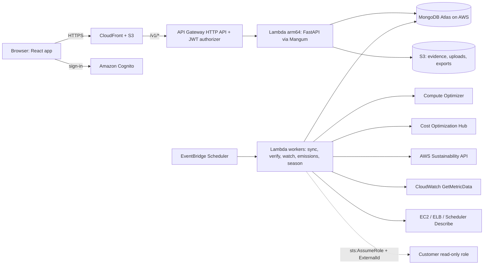

# Overclouded.si

**AWS waste, turned into verified engineering quests.** Overclouded.si finds the "clouds" of waste in an AWS estate, issues missions to engineering teams, **proves** each change worked without hurting performance, and only then rewards the team: points, boss damage, badges, league standing, and a cloud on the map that actually clears.

> Not another carbon dashboard. AWS already has a Sustainability console, Compute Optimizer and Cost Optimization Hub. Overclouded.si is the action-and-reward loop that connects them: *found a potential saving → made the change → tested it → proved it → was rewarded.*


Screens to capture for the submission are listed in [docs/screens.md](docs/screens.md).

## Why it is different

- **Proof-gated gameplay.** No points for accepting a recommendation. Points come only after before/after CloudWatch evidence passes binding guardrails (p95 latency, 5xx rate, CPU/memory headroom, burstable credits, workload comparability).
- **Rewards can be lost.** A revert or regression during the 30-day watch suspends the mission and claws the points back from an append-only ledger.
- **Three honest scores.** Resource Efficiency, Business Efficiency and Environmental Impact are never merged. Emissions are monthly, lagging, display-only and never derived from cost.
- **Read-only.** The platform never touches customer infrastructure; engineers make the change, the platform verifies it.

## Architecture



## Quick start: Sample Data Mode (no AWS account)

Prerequisites: Python 3.14, [uv](https://docs.astral.sh/uv/) 0.8+, Node.js 22, and Docker or Podman.

```bash
make setup      # installs backend, web and infra deps; creates .env with a random dev secret
make dev        # MongoDB container + seed Northwind Retail + API :8000 + web :5173
```

Open http://localhost:5173, choose **Try Sample Data Mode**, sign in as *Priya Raman (engineer)* and follow [docs/JUDGE_QUICKSTART.md](docs/JUDGE_QUICKSTART.md). Use **Demo controls → Advance time** to watch verification happen.

## Deploy and tear down (AWS)

Follow [docs/AWS_ACCOUNT_SETUP.md](docs/AWS_ACCOUNT_SETUP.md) (budget alarm first, SSO profile, CDK bootstrap, opt-ins) and [docs/ATLAS_SETUP.md](docs/ATLAS_SETUP.md), then:

```bash
export AWS_PROFILE=overclouded-deployer
make deploy         # CDK: Auth, Storage, Api, Workers, Web, Observability (+ Budget with -c budgetEmail)
make seed-cloud     # indexes, sample org, Cognito demo users (passwords to SSM SecureString)
make teardown       # type 'destroy' to confirm; removes every stack and bucket
```

The app works on the CloudFront default URL. `overclouded.si` is optional (ACM + DNS; see the setup doc).

## Quality gates

```bash
make lint typecheck        # ruff + mypy --strict, eslint + tsc
make test-unit coverage    # 456 unit/property/contract tests; domain coverage 97%
make test-integration      # 26 tests on a real MongoDB: scenarios A–H, tenant isolation, API
make e2e                   # Playwright: MVP journey, reward denied, 360px, axe
make policy-lint verify-aws check-links synth secret-scan audit
```

## Project structure

```
backend/src/overclouded/
  domain/      pure rules: RI, guardrails, confidence, points, state machine, bosses, leagues…
  adapters/    Protocol interfaces; fixture (simulator), aws (boto3), upload implementations
  repos/       tenant-scoped MongoDB repositories, indexes, migrations
  services/    missions, verification, game, sync, cloud map, emissions, reports, demo
  api/         FastAPI app, auth, routers, Proof Card and impact report renderers
  workers/     EventBridge Scheduler Lambda handlers
  demo/        Northwind Retail catalog, deterministic simulator, scenarios A–H, seed
apps/web/      React + Vite + TypeScript + Tailwind; Cloud Map, Verification Arena, …
infra/         AWS CDK v2 (Python) stacks; customer-role/ CloudFormation template
scripts/       policy lint, seed/reset, OpenAPI export, Lambda bundle, teardown, checks
docs/          everything below
```

## Tech stack

Python 3.14 · FastAPI · Pydantic v2 · PyMongo async · boto3 · Mangum · MongoDB Atlas · AWS Lambda (arm64/Graviton) · API Gateway HTTP API · Cognito · EventBridge Scheduler · CloudFront + S3 · Secrets Manager · CloudWatch · AWS CDK v2 · React 18 · TanStack Query · Tailwind 4 · Playwright + axe.

## Documentation

| Doc | For |
|---|---|
| [JUDGE_QUICKSTART](docs/JUDGE_QUICKSTART.md) | See a verified win in under two minutes |
| [DEMO](docs/DEMO.md) | The 3-minute and 60-second demo scripts |
| [JUDGING_MAP](docs/JUDGING_MAP.md) | The three judging criteria → features → files → demo moments |
| [PITCH](docs/PITCH.md) · [DEVPOST](docs/DEVPOST.md) · [SLIDES](docs/SLIDES.md) | Submission narrative |
| [METHODOLOGY](docs/METHODOLOGY.md) | Every formula with worked examples |
| [LIMITATIONS](docs/LIMITATIONS.md) · [ROADMAP](docs/ROADMAP.md) | What it does not do (yet) |
| [SECURITY](docs/SECURITY.md) · [COST](docs/COST.md) | Threat model and running cost |
| [DECISIONS](docs/DECISIONS.md) · [ASSUMPTIONS](docs/ASSUMPTIONS.md) | Choices made and what still needs verification |
| [TEAM_PLAN](docs/TEAM_PLAN.md) · [AWS_ACCOUNT_SETUP](docs/AWS_ACCOUNT_SETUP.md) · [ATLAS_SETUP](docs/ATLAS_SETUP.md) | Running the project |

Points are a platform feature only. Overclouded.si creates no carbon credits, regulatory credits or compliance benefits, and AWS does not award credits for using it.
